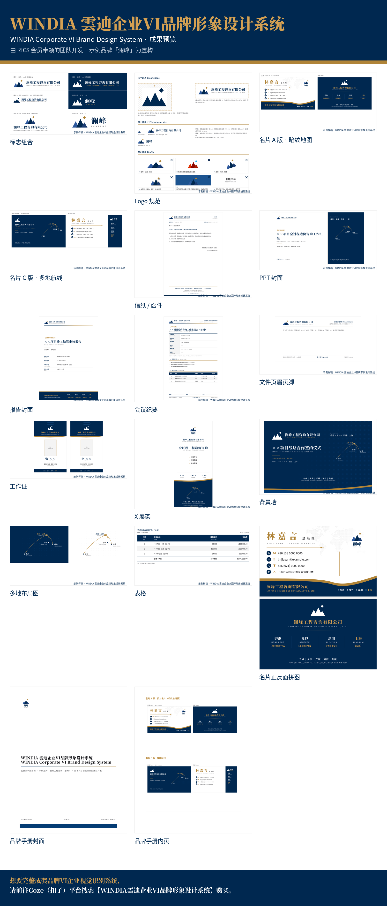

# WINDIA 雲迪企业VI品牌形象设计系统 · Claude 技能

WINDIA Corporate VI Brand Design System — Claude skill (showcase edition)

由 RICS 会员带领的团队开发。本技能用于**展示**这套企业 VI 系统能产出的成果样稿：标志组合与 Logo 规范、名片（暗纹地图版 / 多地航线版）、信纸函件、PPT 封面、报告封面、会议纪要、文件页眉页脚、工作证、X 展架、背景墙、品牌手册等。



> 示例品牌「澜峰工程咨询」及所有人名、电话、邮箱、地址均为虚构。

## 安装

### Claude Code

```
/plugin marketplace add tinofan87-tinooo/windia-skills
/plugin install windia-vi-showcase-cn@windia-skills
```

### Claude.ai / Claude 桌面版

1. 下载本仓库中的 `plugins/windia-vi-showcase-cn/skills/windia-vi-showcase-cn` 文件夹，打包成 zip。
2. 在 Claude 中打开「设置 → 功能 → 技能（Skills）」，上传该 zip。

## 使用

安装后直接问 Claude，例如：

- 「企业 VI 能做哪些物料？」
- 「给我看看 WINDIA 的名片样稿」
- 「品牌手册长什么样？」

## 目录结构

```
.claude-plugin/marketplace.json        插件市场清单
plugins/windia-vi-showcase-cn/
  .claude-plugin/plugin.json           插件清单
  skills/windia-vi-showcase-cn/
    SKILL.md                           技能说明
    assets/showcase/*.png              成果样稿
```

## 完整版

想要完整成套品牌VI企业视觉识别系统，请前往Coze（扣子）平台搜索【WINDIA雲迪企业VI品牌形象设计系统】购买。
